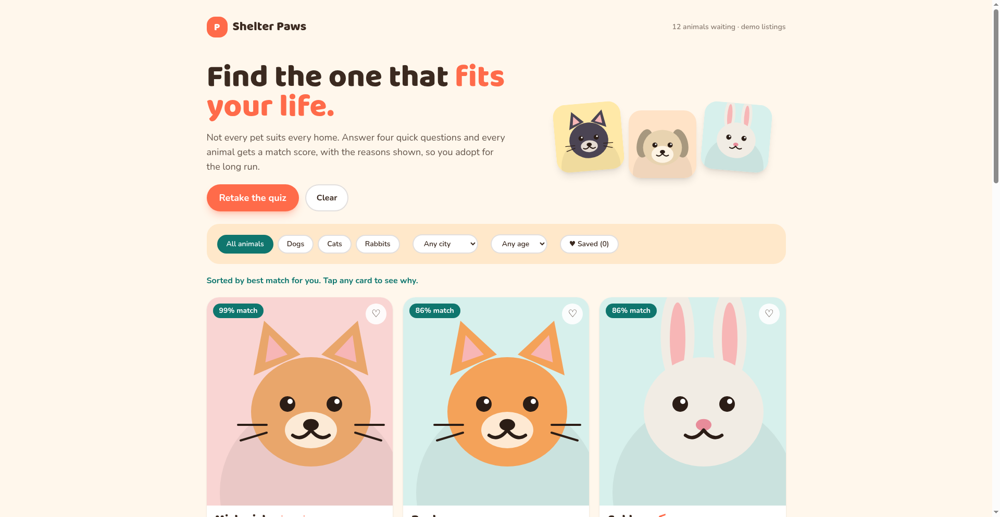

# Shelter Paws

A rescue-adoption site for Egypt that helps people adopt for the long run: answer four questions and every animal gets a match score with the reasons spelled out.

**Live demo:** https://malakmo7amed309.github.io/shelter-paws/



## Standout feature

The honest match quiz. Space, hours alone, experience and who lives at home feed a scoring function (`src/data.js`) that ranks every animal and explains itself: green ticks for what fits, orange warnings for what does not ("Needs a more experienced owner", "Prefers to be the only pet"). It is built to prevent returns, the real problem in adoption, instead of just filtering a grid.

## What's inside

- 12 demo animals (dogs, cats, rabbits) across Cairo, Giza, Alexandria, Fayoum and Mansoura, each with a hand-drawn SVG portrait, so there are no photos to load
- Filters by species, city and age, plus saved favorites
- Detail view with the match breakdown and an adoption inquiry form with validation (Egyptian-friendly phone check)
- Quiz answers, favorites and inquiries persist in localStorage; no backend

Listings and shelters are fictional demo data.

## Stack

React 19, Tailwind CSS 4, Vite (single-file build). Fonts: Baloo 2 and Nunito.

## Run locally

```
npm install
npm run dev
```

Build outputs a single self-contained `dist/index.html` (what GitHub Pages serves from `docs/`).
